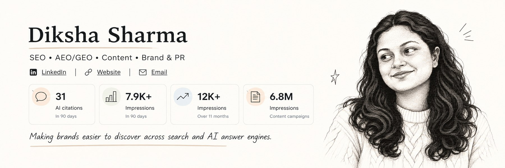

  <h1><strong>Diksha Sharma</strong></h1>
  
<strong>SEO · AEO/GEO · Content Strategy · Brand & PR</strong>

  

    <a href="https://www.linkedin.com/in/dikshasharma005/">LinkedIn</a>
    &nbsp;·&nbsp;
    <a href="https://diksharmaa.com">Website</a>
    &nbsp;·&nbsp;
    <a href="mailto:dikshas1404@gmail.com">Email</a>
  

  

---

## About

I’m a marketing professional working across **SEO, AEO/GEO, content, brand, and PR**. I enjoy connecting strategy with execution—building content systems, testing ideas, and turning insights into useful work.

## Experience

| Role | Organisation | Work arrangement | Dates |
|---|---|---|---|
| **Head of SEO and Content Marketing** | London Taxi Adverts | Remote | July 2025–Present |
| **Freelance SEO Consultant and PR Strategist** | Out Of Office Creative Retreats | Remote | 2025 |
| **Content Strategist** | GetMega | Remote | Oct 2024–Feb 2025 |
| **Freelance SEO Content Strategist and Marketer** | Independent | Remote | 2022–Present |

## Selected Highlights

- **AI visibility:** Built an AEO/GEO system across 90 blogs, with structured data and citation tracking.
- **Automation:** Streamlined publishing with Nimbalyst, Google Sheets, and Semrush API.
- **SEO growth:** Earned 460+ clicks and first-page rankings for core keywords.
- **Content impact:** Supported 7.5% organic traffic growth through content campaigns.
- **B2B & PR:** Created content for Capchase, FRR Forex, and AHA; supported communications for Gulf Oil India and UGRO Capital.

## Projects

*Selected projects will be added here as I build and publish them.*

---

Strategy-minded. Curious by default. Focused on useful outcomes.

